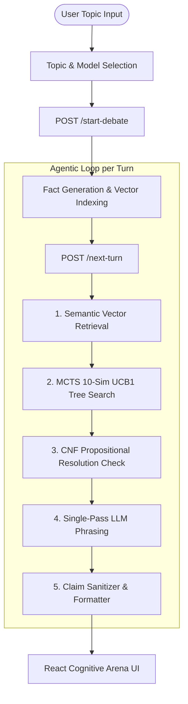

# ⚔️ Agentic Debate Arena with MCTS & Neuro-Symbolic Logic Verification

[](https://www.python.org/downloads/)
[](https://fastapi.tiangolo.com/)
[](https://reactjs.org/)
[](https://vitejs.dev/)
[](backend/tests/)

An autonomous **Neuro-Symbolic Agentic Debate System** where two AI debater agents compete in logic-verified debates on any topic. Strategic move selection is governed by **Monte Carlo Tree Search (MCTS)**, logical self-consistency is enforced via **Conjunctive Normal Form (CNF) Propositional Resolution**, and multi-provider LLMs (**Groq LPUs**, **NVIDIA NIM**, **Google Gemini**) act as grounded verbalizers.

---

## 🌟 Key Features

- 🌳 **Monte Carlo Tree Search (MCTS):** Uses Upper Confidence Bound for Trees (UCB1) over 10-simulation lookahead trees to select optimal rebuttal moves based on net contradiction scoring ($W_i / N_i + C \cdot \sqrt{\ln N_p / N_i}$).
- ⚡ **Propositional Resolution Engine:** Formal CNF resolution theorem proving ($\frac{A \lor B, \neg A}{B}$) that catches logical self-contradictions and cross-agent inconsistencies in real time.
- 📚 **Dynamic Grounded Retrieval:** Vector embedding index with cosine similarity search for on-demand fact retrieval per topic.
- 🤖 **Multi-Provider LLM Orchestration:** Seamlessly swap models for Agent A (Proposer) and Agent B (Opponent):
  - **Groq LPU:** `llama-3.3-70b-versatile` (~300 tokens/sec ultra-fast 70B inference)
  - **NVIDIA NIM:** `nvidia/llama-3.3-nemotron-super-49b-v1`, `meta/llama-3.1-8b-instruct`, `meta/llama-3.3-70b-instruct`
  - **Google Gemini:** `gemini-3.6-flash`, `gemini-3.5-flash`, `gemini-3.1-flash-lite`
- 🎨 **Cognitive Arena UI:** Dark mode precision research board with radiant hairline turn frames, synced status rings, live MCTS decision tree drawers, and contradiction alert badges.

---

## 🏗️ Architecture



---

## 🚀 Quick Start (Single Command)

1. **Clone the repository:**
   ```bash
   git clone https://github.com/adhithya-code/Agentic-Debate-Arena-with-MCTS.git
   cd Agentic-Debate-Arena-with-MCTS
   ```

2. **Configure API Keys:**
   Create a `backend/.env` file with your preferred API keys:
   ```env
   GROQ_API_KEY=gsk_...
   NVIDIA_API_KEY=nvapi-...
   GEMINI_API_KEY=AQ...
   ```

3. **Launch Application:**
   Run the unified launcher script:
   ```bash
   ./run_app.sh
   ```

- **Frontend UI:** [http://localhost:5173](http://localhost:5173)
- **Backend API:** [http://localhost:8000](http://localhost:8000)
- **Swagger Docs:** [http://localhost:8000/docs](http://localhost:8000/docs)

---

## 🧪 Running Tests

The backend includes a comprehensive test suite covering MCTS algorithms, resolution theorem proving, claim cleaning, and API endpoints:

```bash
cd backend
source venv/bin/activate
PYTHONPATH=app pytest tests/ -v
```

---

## 📁 Repository Structure

```
.
├── backend/
│   ├── app/
│   │   ├── agents/          # GeminiAgent & NvidiaAgent (OpenAI / Groq / NVIDIA)
│   │   ├── api/             # FastAPI route handlers (/start-debate, /next-turn)
│   │   ├── core/            # MCTS, Resolution Engine, Retrieval & Knowledge Base
│   │   ├── models/          # Pydantic schemas
│   │   └── tools/           # Function calling tool schemas & executor
│   ├── tests/               # 231 unit & integration tests
│   └── requirements.txt
├── frontend/
│   ├── src/
│   │   ├── components/      # DebateArena, ClaimCard, MCTSTracePanel, StatusRing
│   │   ├── lib/             # API client & theme hooks
│   │   └── styles/          # Vanilla CSS precision research board styles
│   └── package.json
└── run_app.sh               # Unified bash launcher for backend + frontend
```

---

## 🛡️ License

MIT License. Developed for advanced agentic AI research & debate logic verification.
